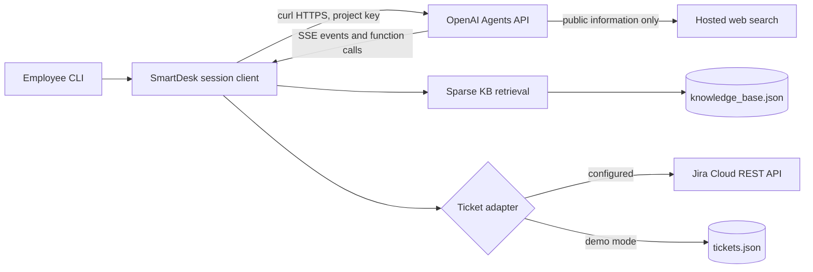

# SmartDesk AI Assistant

SmartDesk AI is a portable first-line IT and HR help desk. It uses a reusable OpenAI Agents API agent, grounds company answers in an included knowledge base, streams session events, and routes ticket creation and status checks through application function tools. Jira Cloud is supported; a local JSON ticket store makes the sample usable without Jira credentials.

## Requirements

- Node.js 20.6 or newer
- `curl` available on `PATH` (or set `CURL_PATH` to its executable)
- An OpenAI API key with `api.agents.read`, `api.agents.write`, and `api.responses.write` permissions
- Optional Jira Cloud project, user email, and API token for real tickets

The app has no third-party runtime package dependencies. Its configuration and data paths are relative to this folder, so the complete folder can be copied to another machine or environment.

## Setup

1. Copy `.env.example` to `.env`.
2. Set `OPENAI_API_KEY` in `.env`. The project ID defaults to the requested `proj_2mzAhWk9r2mmsb1MA1Wfq1h1` and can be changed with `OPENAI_PROJECT_ID`.
3. Optionally configure Jira Cloud using the four `JIRA_*` variables shown below.
4. Run `npm start`.

On first start, the app creates the reusable `New agent` definition through `POST /v1/agents`, saves the returned ID locally in the ignored `data/agent.json`, and starts a session using that ID. It sends an initial greeting, streams output and events, handles function calls, then opens an interactive prompt. Set `OPENAI_AGENT_ID` to reuse an existing compatible saved agent in another environment.

The API key is read only from the environment and is never embedded in agent tools or sent into an agent execution environment. User `.env` files, runtime agent IDs, and local tickets are git-ignored.

## Configuration

| Variable | Required | Purpose |
| --- | --- | --- |
| `OPENAI_API_KEY` | Yes | OpenAI API authentication |
| `OPENAI_PROJECT_ID` | No | Project header; defaults to the requested project |
| `OPENAI_AGENT_ID` | No | Reuse a saved agent instead of creating one |
| `OPENAI_MODEL` | No | Model for new saved agents; defaults to `gpt-6-astra` |
| `CURL_PATH` | No | Full path to `curl` if it is not on `PATH` |
| `SMARTDESK_INITIAL_MESSAGE` | No | Change the initial user message sent with the new session |
| `JIRA_BASE_URL` | Optional | Jira Cloud site, such as `https://example.atlassian.net` |
| `JIRA_EMAIL` | Optional | Jira account email for API-token basic authentication |
| `JIRA_API_TOKEN` | Optional | Jira API token; keep it in `.env` or a secret manager |
| `JIRA_PROJECT_KEY` | Optional | Jira project where SmartDesk creates issues |

Configure all four Jira values to enable Jira. With no complete Jira configuration, the app stores sample tickets in `data/tickets.json`. The local store is meant for demos and is not shared between environments.

## How it works

- **Knowledge base:** 49 fictional Northstar Systems policy entries in `data/knowledge_base.json`, covering IT, HR, payroll, and onboarding. Replace or extend the JSON file with approved company material.
- **Retrieval:** lightweight sparse keyword ranking, title weighting, and a 0.4 relevance threshold. No match means the agent acknowledges uncertainty and offers escalation.
- **Tickets:** function calls execute in the local Node application. The ticket handler stages a proposal first; it writes a Jira issue or local ticket only after an explicit affirmative user message for that same proposal.
- **Status:** lookups require an employee email. Multiple tickets are listed for selection; no matches are reported plainly.
- **Agents API:** creates the reusable agent, starts an `environment: { "type": "none" }` session, sends the first message with streaming enabled, consumes events, returns function results, and streams follow-up turns. No sandbox executor is needed because the app process runs the custom tools.
- **Web search:** enabled for public, general information only. Company answers must use retrieved knowledge base entries.

## Commands

```sh
npm start
npm run agent:create
npm run kb:check
npm test
```

`npm run agent:create` creates a new saved agent and writes its ID to the ignored `data/agent.json`. `npm run kb:check` shows sample retrieval results without an API key. The tests use Node's built-in test runner and mocked Jira responses; they do not require OpenAI or Jira credentials.

## Ticket setup for Jira Cloud

Create an API token and Jira project, then set `JIRA_BASE_URL`, `JIRA_EMAIL`, `JIRA_API_TOKEN`, and `JIRA_PROJECT_KEY`. The app creates Jira Task issues with the employee email, category, and priority in the description and labels. Status lookup searches the configured project for the employee email and returns matching status and recent comments. Verify your Jira site's permissions, issue type, and project settings before using it with employees.

## Architecture



## Data and privacy notes

The included policies are fictional examples, not real company policy. Replace them before employee use. Jira credentials remain in the application environment and are used only for Jira requests. The employee email and ticket description are sent to Jira when the ticket is confirmed. Local tickets are stored as plain JSON in the project data folder.

## Testing

Run `npm test` for the scenario suite. The Word report `SDA_Test_Document.docx` records the exact run count and boundaries. A live API session could not be started during this build because `OPENAI_API_KEY` was not present in the environment; after configuring it, `npm start` creates/uses the agent, sends the initial message, and begins streaming.

